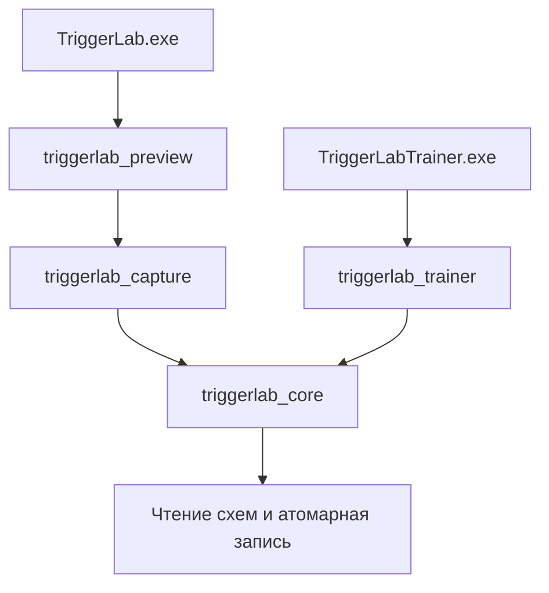

# Архитектура TriggerLab

## Цели и зависимости

Приложение анализирует небольшой участок экрана и отправляет клик при подтверждённом наведении. Отдельный тренажёр моделирует сцену без внешнего ввода.

Ядро собирается на Windows и Linux. Заголовки `include/triggerlab` не подключают `windows.h`. Платформенная реализация атомарной замены скрыта в .cpp.

| Область | Файлы | Ответственность |
|---|---|---|
| Обнаружение | ColorMask, AnalyzerSettings, TargetDetector, ImageColor | Цвет, область, прицел, палитра |
| Состояние | HoverClickGate, InputAuthorization, ClickPermission | Задержка, одно срабатывание на наведение, допуск |
| Тренажёр | Simulation, TriggerEngine, Diagnostics | Локальная сцена и измерение симулированных срабатываний |
| Хранение | src/persistence | Версии схем, профили, ограниченное чтение, атомарная запись |
| Windows | ScreenCapture, ImageFile, ClickPulse | GDI/WIC и отправка Down/Up |
| Интерфейс | src/win32/preview, src/win32/trainer | Окна, управление, отрисовка и пользовательские состояния |

## Организация интерфейса

`preview_main.cpp` управляет временем жизни приложения и циклом сообщений. `PreviewWindow` остаётся координатором одного окна; его состояние закрыто. Реализации сгруппированы по ответственности: Settings, Capture, Input, Controls, Layout, Feedback и Paint.

Разбиение файлов не создаёт независимые контроллеры: эти части совместно используют состояние окна. Переносимые правила обнаружения и допуска уже вынесены в ядро. При появлении второго потребителя следует выделять модель по реальному общему поведению, а не добавлять интерфейсы для каждого вызова Win32.

`TrainerWindow` разделён на управление, обновление сцены и отрисовку. GDI-поверхности имеют единственного владельца; копирование запрещено. Окна уничтожаются до освобождения их ресурсов.

Все публичные операции захвата и ClickPulse принадлежат одному потоку интерфейса. Только callback ClickPulse работает в пуле потоков; он защищает состояние mutex и не обращается к контролам. UI забирает результат на своём потоке.

Таймеры анализатора: захват, отсчёт выбора и восстановление отпускания. Их ID, ID горячей клавиши и контролов определены в `ControlIds.hpp`.

## Инварианты ввода

1. Запуск приложения начинает диагностику с выключенными кликами.
2. Для реального ввода нужны выбранный цвет, сохранённые параметры и успешная проверка.
3. Клик требует свежего кадра, выбранного активного окна, сохранённого PID и доступности всей области.
4. Уход с цвета разрешает следующее наведение. Ошибка захвата прерывает выдержку, но сама по себе не подтверждает уход.
5. Down считается отправленным только после подтверждения Windows. Отклонённый Up сохраняет владение нажатием и блокирует новый Down.
6. Сохранённые изображения и эталоны не подаются на вход генерации кликов.

Геометрия использует физические пиксели и поддерживает отрицательные координаты мониторов. Отдельные копии кадра предназначены для обнаружения и показа последнего результата.

## Форматы и ошибки

Числовые JSON-схемы используют общий внутренний `NumericObjectReader`. Он принимает только плоский объект чисел; вложенные значения, строки, дубликаты и хвост запрещены. Проверка обязательных ключей, версии и диапазонов остаётся у каждой схемы. Старые RGB-профили версии 1 продолжают читаться.

Запись использует уникальный временный каталог рядом с файлом и атомарную замену. На Windows операции одного назначения сериализуются именованным mutex. Последняя успешная запись побеждает; транзакция между файлом цвета и файлом параметров не предоставляется.

Ошибки сборки остаются в BAT-логе, ошибки инициализации — в `startup.log` и диалоге. Недоступный снимок явно сбрасывает текущий кадр.

## Тестовые границы

`TriggerLabUiTests` использует отдельную сборку GUI с `TRIGGERLAB_UI_TESTS`; friend-адаптер получает доступ к состоянию для сценариев интерфейса. Диалоговые пробы подключаются только в этой сборке. `TriggerLabTrainerTests` проверяет отдельный стенд.

Выпускаемые приложения не содержат диспетчера тестовых CLI-команд. Сборка с `TRIGGERLAB_BUILD_TESTS=OFF` не создаёт тестовых целей. CI дополнительно собирает и упаковывает именно этот вариант.

Тесты покрывают ядро, схемы, конкурирующие записи, захват собственных окон, DPI/разметку, подсказки, наведение и восстановление ввода. GitHub runner не заменяет ручную проверку конкретного тренажёра и компьютера: [методика](trainer-validation.md).
